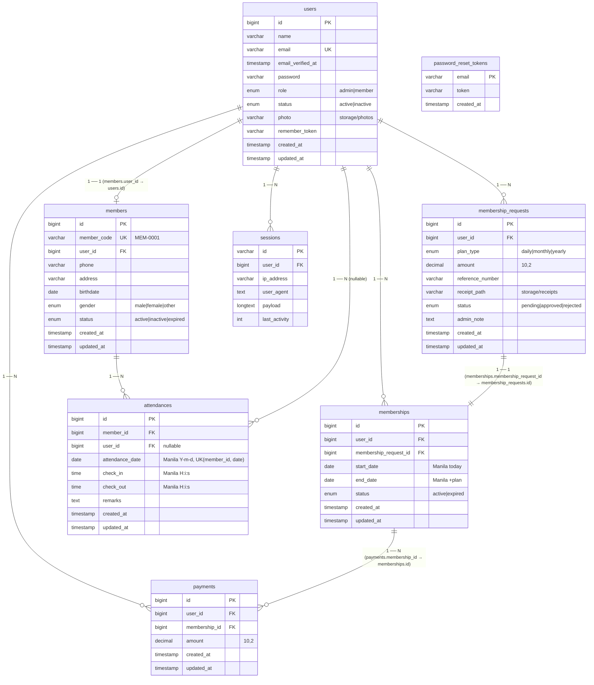

# FitPay — ERD & SQL Schema

**DB:** MySQL 8 / InnoDB `utf8mb4_unicode_ci` · **Timezone:** `Asia/Manila` (`APP_TIMEZONE`) · **Generated:** 2026-09-08 from `backend/database/migrations`

Import the full SQL at **`fitpay/schema.sql`** (run `mysql -u root -p < schema.sql` or `php artisan migrate`) or paste **`fitpay/schema.dbml`** at [dbdiagram.io](https://dbdiagram.io/d) for an interactive ERD.

---

## Mermaid ERD (GitHub / GitLab preview)



### How the 3 payment tables link (the “approved by default” flow)

```
membership_requests (pending) ──admin approves──> memberships (active, start today Manila, end +plan)
        │                                              │
        │ 1 ── 1 (memberships.membership_request_id)    │ 1 ── N
        └──────────────────────────────────────────────┘
                              │
                              ▼
                          payments (user_id, membership_id, amount)
```

**`POST /api/payments` (admin)** in `PaymentController@store` does all three in one `DB::transaction`:
`MembershipRequest(approved)` → `Membership(active)` → `Member.status=active` → `Payment`.  
If `membership_id` is supplied, it just links the payment to the existing membership (verifies `user_id` matches).

### Quick import

```bash
# from fitpay/
mysql -u root -p -e "CREATE DATABASE fitpaydb CHARACTER SET utf8mb4 COLLATE utf8mb4_unicode_ci;"
mysql -u root -p fitpaydb < schema.sql
php artisan storage:link   # for /storage receipt/photo URLs
php artisan migrate --seed # seeds admin@fitpay.test / member@fitpay.test (password) + 24 members
```

See **`schema.dbml`** for dbdiagram.io and **`schema.sql`** for MySQL Workbench / `phpMyAdmin` → *Import* → ERD auto-layout.

---

## Table counts / seed

- `admin@fitpay.test` (admin) + `member@fitpay.test` (member/MEM-0001) + 24 factory members
- All `members.status` defaults `active`, `memberships.status` `active`, `membership_requests.status` `pending`
